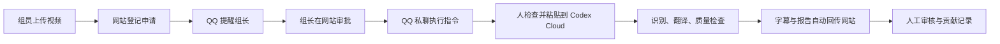

# 字幕协作台 · 开源社区版

把一个视频交给字幕组，留下每次交付、审核和贡献的记录。

这里公开了这个项目自己编写的网站前端、PostgreSQL 后端、Codex Cloud 字幕程序、QQ 机器人插件、部署脚本、测试和技术记录。你可以学习它、改造它，也可以为自己的字幕组搭建一套。

**第一次接触这些工具？从 [从零搭建](docs/从零搭建.md) 开始。只想使用已经搭好的网站？看 [组员与组长使用手册](docs/使用手册.md)。**

## 它已经能做什么

- 成员注册与审批；项目负责人、审核员和普通成员分别授权。
- 项目、任务、认领、交付版本、审核、贡献履历和积分流水。
- 按任务类型交付字幕、视频或封面；私有文件下载时校验大小与 SHA-256。
- 最长 **20 分钟 / 1 GiB** 的视频申请，组长审核后生成准确的云端执行指令。
- QQ 群内 @ 组长，同时私聊新申请；审批后私聊执行指令；处理结果私聊提醒。
- Codex Cloud 领取指定作业，生成 ASS、SRT 和报告，再自动回传到网站。
- 任务待办、截止时间、反馈摘要、找回密码、回收站、受控硬删除、7 天原视频清理。
- 云执行身份的创建、撤销、备注修改和已撤销身份的删除/恢复。

**这是半自动工作流。** 网站和 QQ 机器人不会替人登录 ChatGPT，也不会自动启动 Codex Cloud。人工启动之后，已配置好的字幕程序负责领取与回传。QQ 自动检查时间为北京时间 **00:00、07:00、12:00、16:00**，因此提醒不是实时的。

## 先体验，再决定搭建

1. 点击 GitHub 页面上的 **Code → Download ZIP**，解压。
2. 打开 `docs/使用手册.html`，不登录、不安装软件即可阅读日常使用说明。
3. 要搭建自己的平台，按 [从零搭建](docs/从零搭建.md) 准备账户，双击 `开始配置.cmd`，生成属于你自己的部署文件。
4. 按教程把网站、数据库、云环境和机器人分别接好。每个阶段都有验收方法，可以分阶段完成。

下载源码不等于获得云服务额度。CloudBase、服务器、Codex 账户和模型服务各有自己的费用、权限及可用地区，开通前以各服务页面为准。本仓库的配置工具只生成本地文件，不自动购买、升级或调用收费模型。

## 仓库导航

| 目录 | 装着什么 | 谁通常需要看 |
| --- | --- | --- |
| `site/` | 当前网站的完整静态页面和脚本 | 搭建者、前端开发者 |
| `database/` | 表、权限、业务函数、迁移清单 | 搭建者、后端开发者 |
| `worker/` | 识别、翻译、检查、交付与请求账本 | Cloud 环境配置者 |
| `bot/plugins/` | QQ 身份绑定、通知、指令私聊和清理程序 | 机器人管理员 |
| `ops/` | Docker 部署与运维工具 | 服务器管理员 |
| `tools/` | 本地部署生成、检查和发布辅助工具 | 搭建者、维护者 |
| `tests/` | 使用虚构账号和模拟网络的回归测试 | 开发者 |
| `experiments/` | 初版工作器、未启用的调度器、历史诊断 | 想研究过程的人 |
| `docs/` | 中文教程、架构、安全、费用和排错 | 所有人 |

## 接下来读什么

- [从零搭建](docs/从零搭建.md)：从账号、下载到第一次完整验收。
- [使用手册](docs/使用手册.md)：组员、组长、PC、安卓端的日常操作。
- [请助手协助搭建](docs/请助手协助搭建.md)：不会使用终端时如何协作，以及出错时提供哪些信息。
- [系统如何工作](docs/架构与数据.md)：权限矩阵、数据结构与消息流。
- [维护与故障排查](docs/维护与排错.md)：费用、备份、恢复、密钥与异常处理。
- [开发与测试](docs/开发与测试.md)：运行检查、贡献代码、已验证范围。
- [开源范围与历史](docs/开源范围.md)：哪些实现已公开，哪些材料不属于可分发源码。
- [第三方声明](THIRD_PARTY_NOTICES.md)、[安全报告方式](SECURITY.md)、[贡献指南](CONTRIBUTING.md)。

## 许可与当前边界

本项目自己的代码和文档使用 **AGPL-3.0-only**，见 [LICENSE](LICENSE)。允许使用、修改和分发；修改后通过网络提供服务时，需按许可证向使用者提供相应源码。第三方代码保留各自许可。

这是从实际小型字幕组项目整理的首个社区版本。源码与离线测试已经整理，**没有替你在一个新云账户中完成部署验收**；请先使用测试环境和自己有权处理的短视频。实际限制和本次验证记录见 [验证状态](docs/验证状态.md)。

云端剪辑已退出正式流程，完整自动启动仍是实验。原始视频、成员资料、密码、API Key、聊天原文、生产备份与通知账本均不包含在仓库中。开源的是实现与方法，每个字幕组使用自己的账户和资料。
